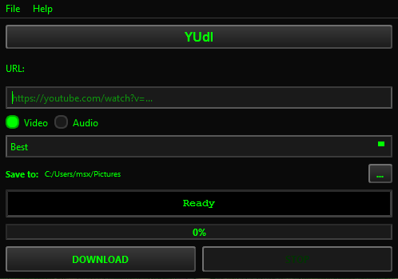

# YUdl

**English** | [Українська](README.uk.md)


<p align="center">
  
</p>

**YouTube downloader with a graphical interface.** Python + PyQt6 + yt-dlp.
Paste a link, pick a format, press download — that's it.

Version **1.0.2** · author **msx** · © 2026

## Features

- Simple window: link → Video / Audio → quality or format → progress.
- **Video** — MP4 in Best, 720p or 480p.
- **Audio** — MP3 320 kbps, WAV, FLAC or M4A.
- Progress bar and a **STOP** button.
- Interface languages: **English**, **Русский**, **Українська**.
- **FFmpeg downloads itself** next to the program — nothing to install by hand.
- Background music toggle.
- Download folder is selectable and remembered.

## Running

### 1. Clone the repository

```bash
git clone https://github.com/RoboLask/YUdl
```

### 2. Go to the folder and install dependencies

```bash
cd YUdl
pip install -r requirements.txt
```

If `pip` is not found:

```bash
python -m pip install -r requirements.txt
```

Python **3.8+** is required. If it is missing, install it from
[python.org](https://www.python.org/downloads/) and tick **Add Python to PATH**.

### 3. Run

```bash
python main.py
```

On Windows you can also just double-click `main.py`.

On Linux / macOS use `python3 main.py` inside the virtual environment.

A ready-to-run Windows binary is in `bin/YUdl.exe` — no Python needed.

## Usage

1. Paste a YouTube link into the **URL** field.
2. Choose **Video** or **Audio**.
3. Pick the quality (Best / 720p / 480p) or the audio format.
4. Select the download folder if needed — the default is your **Downloads**.
5. Press **DOWNLOAD** and wait for the progress bar to finish.

## Formats

| Type | Options | Notes |
|---|---|---|
| Video | Best, 720p, 480p | MP4, merged with FFmpeg |
| Audio | MP3 | 320 kbps, plays everywhere |
| Audio | WAV | uncompressed, large files |
| Audio | FLAC | lossless |
| Audio | M4A | good for iPhone / iTunes |

## FFmpeg

FFmpeg is not shipped in the repository — it is downloaded into the `ffmpeg/`
folder next to the program if it is not found nearby or in `PATH`.

- **Windows** — `github.com/yt-dlp/FFmpeg-Builds` (fallback: `github.com/BtbN/FFmpeg-Builds`)
- **Linux** — `github.com/BtbN/FFmpeg-Builds` (fallback: `johnvansickle.com`)
- **macOS** — `osxexperts.net`

The progress is shown in the status area: `Downloading FFmpeg 42%`.
Already have FFmpeg? Put `ffmpeg` and `ffprobe` into `ffmpeg/` next to the
program and nothing will be downloaded.

## Settings

Open **File → Settings**:

- **Background music** — turn the built-in music on or off.
- **Language** — English, Русский or Українська.

Settings are stored in `~/.yudl_settings.json`:

```json
{
  "music": true,
  "output_path": "C:/Users/me/Downloads",
  "language": "en"
}
```

| Field | What it sets | Options |
|---|---|---|
| `music` | background music | `true`, `false` |
| `output_path` | download folder | any folder |
| `language` | interface language | `en`, `ru`, `uk` |

## Project structure

```
main.py           window, download logic and translations
ffmpeg_setup.py   FFmpeg finder and auto-download
requirements.txt  Python dependencies
1.wav             background music
bin/              built binary
ffmpeg/           downloaded FFmpeg (created automatically)
docs/             screenshot
```

## Troubleshooting

**`python` is not recognized**

Python is not in `PATH`. Reinstall it with **Add Python to PATH**, or try:

```bash
py main.py
```

**`pip` is not recognized**

```bash
python -m pip install -r requirements.txt
```

**FFmpeg download fails**

The program shows the error in the status area. Check your connection or a
proxy / VPN, then press **DOWNLOAD** again. As a fallback, download FFmpeg
manually and put `ffmpeg` and `ffprobe` into `ffmpeg/` next to the program.

**Download seems stuck at 95%**

This is normal — FFmpeg is converting the file. Wait a minute or two.

**Invalid YouTube URL**

Use a link like `https://youtube.com/watch?v=...` or `https://youtu.be/...`.

## Legal

This program is for **personal use only**. Respect YouTube's Terms of Service
and copyright law. You are responsible for what you download.

---

© 2026 msx
