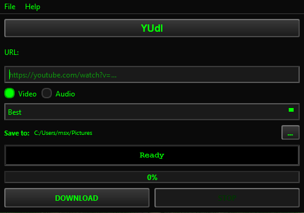

# YUdl

[English](README.md) | **Українська**


<p align="center">
  
</p>

**Завантажувач YouTube із графічним інтерфейсом.** Python + PyQt6 + yt-dlp.
Вставив посилання, вибрав формат, натиснув «Завантажити» — усе.

Версія **1.0.2** · автор **msx** · © 2026

## Можливості

- Просте вікно: посилання → Відео / Аудіо → якість або формат → прогрес.
- **Відео** — MP4 у якості Best, 720p або 480p.
- **Аудіо** — MP3 320 кбіт/с, WAV, FLAC або M4A.
- Смуга прогресу та кнопка **STOP**.
- Мови інтерфейсу: **English**, **Русский**, **Українська**.
- **FFmpeg завантажується сам** поруч із програмою — нічого не треба
  ставити вручну.
- Перемикач фонової музики.
- Папка завантаження вибирається та запам'ятовується.

## Запуск

### 1. Клонувати репозиторій

```bash
git clone https://github.com/RoboLask/YUdl
```

### 2. Зайти в папку та встановити залежності

```bash
cd YUdl
pip install -r requirements.txt
```

Якщо `pip` не знайдено:

```bash
python -m pip install -r requirements.txt
```

Потрібен Python **3.8+**. Якщо його немає — встанови з
[python.org](https://www.python.org/downloads/) і постав галочку
**Add Python to PATH**.

### 3. Запустити

```bash
python main.py
```

На Windows можна просто двічі клікнути `main.py`.

На Linux / macOS запускай `python3 main.py` усередині віртуального середовища.

Готова збірка для Windows лежить у `bin/YUdl.exe` — Python не потрібен.

## Використання

1. Встав посилання YouTube у поле **URL**.
2. Вибери **Відео** або **Аудіо**.
3. Вибери якість (Best / 720p / 480p) або формат аудіо.
4. За потреби зміни папку завантаження — за замовчуванням це **Downloads**.
5. Натисни **DOWNLOAD** і дочекайся завершення смуги прогресу.

## Формати

| Тип | Варіанти | Примітки |
|---|---|---|
| Відео | Best, 720p, 480p | MP4, склеюється через FFmpeg |
| Аудіо | MP3 | 320 кбіт/с, грає всюди |
| Аудіо | WAV | без стиснення, великі файли |
| Аудіо | FLAC | без втрат |
| Аудіо | M4A | зручно для iPhone / iTunes |

## FFmpeg

FFmpeg не лежить у репозиторії — він завантажується в папку `ffmpeg/` поруч із
програмою, якщо його не знайдено поблизу або в `PATH`.

- **Windows** — `github.com/yt-dlp/FFmpeg-Builds` (запасний: `github.com/BtbN/FFmpeg-Builds`)
- **Linux** — `github.com/BtbN/FFmpeg-Builds` (запасний: `johnvansickle.com`)
- **macOS** — `osxexperts.net`

Прогрес показується в рядку стану: `Завантаження FFmpeg 42%`.
FFmpeg вже є? Поклади `ffmpeg` і `ffprobe` у папку `ffmpeg/` поруч із
програмою — і нічого не буде завантажуватись.

## Налаштування

Відкрий **File → Settings**:

- **Background music** — увімкнути або вимкнути вбудовану музику.
- **Language** — English, Русский або Українська.

Налаштування зберігаються у `~/.yudl_settings.json`:

```json
{
  "music": true,
  "output_path": "C:/Users/me/Downloads",
  "language": "en"
}
```

| Поле | Що задає | Значення |
|---|---|---|
| `music` | фонова музика | `true`, `false` |
| `output_path` | папка завантаження | будь-яка папка |
| `language` | мова інтерфейсу | `en`, `ru`, `uk` |

## Структура проєкту

```
main.py           вікно, логіка завантаження та переклади
ffmpeg_setup.py   пошук і автоскачування FFmpeg
requirements.txt  залежності Python
1.wav             фонова музика
bin/              готова збірка
ffmpeg/           завантажений FFmpeg (створюється автоматично)
docs/             скриншот
```

## Проблеми

**`python` не розпізнається**

Python не в `PATH`. Перевстанови з **Add Python to PATH** або спробуй:

```bash
py main.py
```

**`pip` не розпізнається**

```bash
python -m pip install -r requirements.txt
```

**Не вдається завантажити FFmpeg**

Програма покаже помилку в рядку стану. Перевір інтернет або проксі / VPN і
натисни **DOWNLOAD** ще раз. Запасний варіант: завантаж FFmpeg вручну та
поклади `ffmpeg` і `ffprobe` у папку `ffmpeg/` поруч із програмою.

**Завантаження ніби застрягло на 95%**

Це нормально — FFmpeg конвертує файл. Зачекай хвилину-дві.

**Invalid YouTube URL**

Використовуй посилання виду `https://youtube.com/watch?v=...` або
`https://youtu.be/...`.

## Правове

Програма призначена **лише для особистого використання**. Поважай умови
використання YouTube і авторське право. Ти відповідаєш за те, що завантажуєш.

---

© 2026 msx
